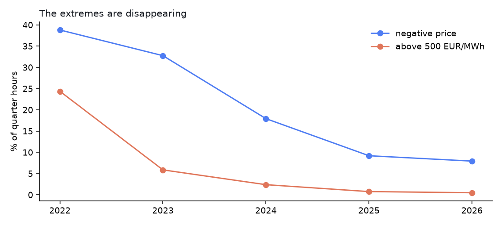
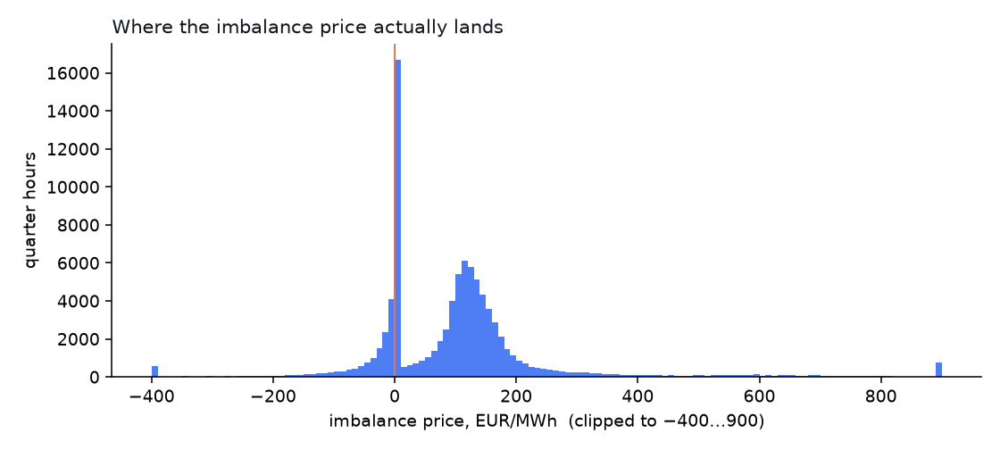
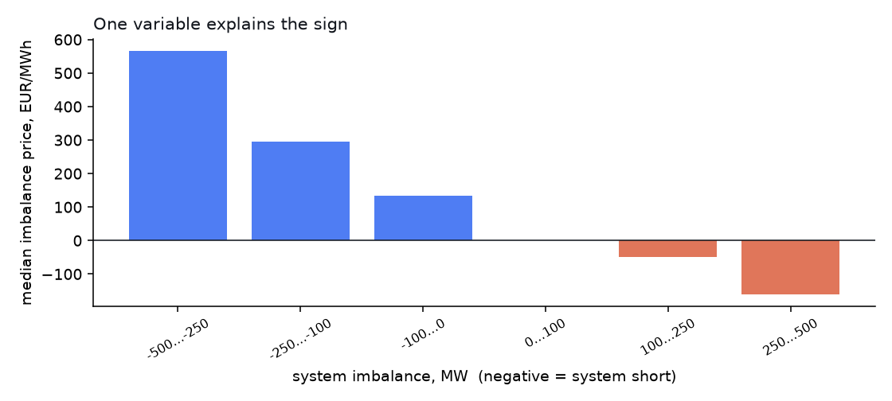

# Anatomy of the Czech imbalance price

What the imbalance settlement price actually does, measured on **92 018
quarter hours** between January 2022 and August 2026.

Not a forecast, not a strategy. A description of a price that a lot of people
trade against without knowing its shape.



## Five things the data says

**1. The average is a lie.** Median 103.6 EUR/MWh, mean 103.8 — they agree,
which normally means a well-behaved distribution. It is not one. The range runs
from **−14 879 to +12 406 EUR/MWh**, and a quarter of all quarter hours settle
at exactly 0.0.

| | EUR/MWh |
|---|---|
| p1 | −242 |
| p5 | −46 |
| p25 | **0** |
| p50 | 104 |
| p75 | 145 |
| p95 | 343 |
| p99 | 807 |

**2. The tail is where the money is.** Negative prices and prices above 500
together are **18.6 % of quarter hours but 35.9 % of the total magnitude**.
Any model evaluated on mean error is being graded on the part that does not
matter.

**3. The sign follows one variable, and only the sign.**

| system | quarter hours | median | p5 | p95 |
|---|---|---|---|---|
| **short** (imbalance < 0) | 55 649 | **134.3** | 72.0 | 543.1 |
| **long** (imbalance > 0) | 36 369 | **0.0** | −125.8 | 88.9 |

When the system is short, the price is high; when it is long, the price
collapses to zero or below. The relationship is monotone in the size of the
imbalance too:

| system imbalance, MW | quarter hours | median price |
|---|---|---|
| −500 … −250 | 97 | 565.6 |
| −250 … −100 | 1 500 | 295.9 |
| −100 … 0 | 54 043 | 133.1 |
| 0 … 100 | 34 798 | 0.0 |
| 100 … 250 | 1 505 | −48.1 |
| 250 … 500 | 66 | −160.9 |

And yet the correlation between imbalance and price is only **−0.349**. That
gap is the whole story: **the imbalance tells you the sign reliably and the
magnitude barely at all.**

**4. The market has changed, a lot.** Anything fitted on 2022 describes a
market that no longer exists:

| year | quarter hours | median | negative | above 500 | system short |
|---|---|---|---|---|---|
| 2022 | 7 438 | 121.8 | **38.8 %** | **24.4 %** | 52.4 % |
| 2023 | 7 343 | 0.0 | 32.8 % | 5.9 % | 43.7 % |
| 2024 | 21 417 | 83.7 | 17.9 % | 2.4 % | 51.9 % |
| 2025 | 34 992 | 102.3 | 9.2 % | 0.7 % | 64.6 % |
| 2026 | 20 828 | 121.0 | 7.9 % | **0.5 %** | **71.1 %** |

Extreme prices have collapsed by a factor of fifty since 2022, while the share
of quarter hours in which the system is short rose from 52 % to 71 %. A result
that does not hold in each year separately is a result about 2022.

**5. The day-ahead price tells you almost nothing about it.** Median difference
between imbalance price and day-ahead price: **2.5 EUR/MWh**. Centred, and with
a spread of hundreds. The imbalance price is not the day-ahead price plus a
premium — it is a different variable.




## What this means if you are modelling it

- **Predict the sign, not the level.** The sign is learnable; the magnitude is
  dominated by a tail that no feature set we have seen explains.
- **Evaluate per year.** With a market this non-stationary, a five-year average
  hides that the regime flipped twice.
- **Watch out for which price you used.** The settlement price is published
  first as an *estimate* and overwritten; the final value comes from OTE the
  next day. Training on the final value and claiming you could have traded on
  it is look-ahead bias — the most common error on this market.
- **Zero is a real value, not a missing one.** A quarter of all quarter hours
  settle at exactly 0.0. Dropping them as nulls removes the entire long-system
  regime from your sample.

## Reproduce it

This repository ships **no market data**. Bring your own and point the script
at it:

```bash
python3 imbalance_stats.py your_data.csv --out data
```

Input is one row per quarter hour with a date, a time, the imbalance price, the
system imbalance and optionally the day-ahead price. Column names are flags:

```bash
python3 imbalance_stats.py qh.csv \
  --date-col date --time-col time \
  --price-col imbalance_price --imbalance-col system_imbalance \
  --da-col day_ahead
```

**Where to get the inputs**

- System imbalance, per quarter hour or per minute — ČEPS, free, no key:
  [ceps-ote](https://github.com/whipeeer-creator/ceps-ote)
- Final imbalance price — OTE yearly market reports
  ([ote-cr.cz](https://www.ote-cr.cz/en), Statistics → Yearly report)
- Day-ahead price — the yearly reports too, or
  [european-power-prices](https://github.com/whipeeer-creator/european-power-prices)

Standard library only, except the charts, which use matplotlib if it is
installed and are skipped if it is not.

## What is in `data/`

Aggregated results, not raw market data:

| file | |
|---|---|
| `distribution.csv` | percentiles and tail shares |
| `summary_by_year.csv` | the year-by-year table above |
| `by_system_sign.csv` | price split by sign of the imbalance |
| `price_vs_imbalance.csv` | median price per imbalance band |
| `*.png` | the three charts |

## Caveats

Quarter hours with a missing price or imbalance are dropped; 2022 and 2023 have
fewer rows because parts of those years were settled hourly. The 2026 figures
end in August. Percentiles are positional, without interpolation — with 92k
points the difference is in the decimals.

This describes the **Czech** market. The direction of the relationships is
common to most European balancing markets; the levels are not.

## Licence

[MIT](LICENSE) for the code, [CC0](LICENSE-DATA) for the aggregated results in
`data/`. The underlying market data belongs to ČEPS and OTE and is not
redistributed here.

## Related

- [aFRR and mFRR explained](https://progrunners.com/afrr-mfrr/) — what they are, how often they are activated and what balancing energy costs, with measured figures

- [ceps-ote](https://github.com/whipeeer-creator/ceps-ote) — get the inputs
- [european-power-prices](https://github.com/whipeeer-creator/european-power-prices) —
  day-ahead prices for 12 zones since 2022
- [awesome-european-energy-data](https://github.com/whipeeer-creator/awesome-european-energy-data) —
  the same data for the rest of Europe
- [Czech market data guide](https://progrunners.com/cs/market-data/czechia/)

Maintained by [progrunners](https://progrunners.com/) — trading dashboards and
market data pipelines for European power markets.
